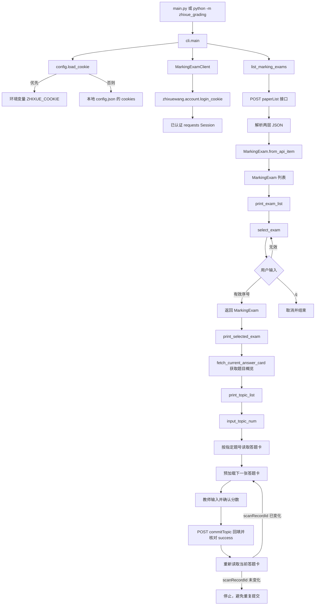

# 当前程序调用链

本项目当前实现的功能是：使用教师已登录会话查询“阅卷中”的考试，并由用户在终端选择其中一场。尚未实现答题卡读取、AI 评分或分数回填。

## 运行入口

可从项目根目录运行以下任一命令：

```powershell
python main.py
# 或
python -m zhixue_grading
```

`main.py` 仅保留为兼容入口，实际调用 `zhixue_grading.cli.main()`。
IDE 若直接运行 `zhixue_grading/cli.py` 也可正常工作，但推荐仍使用前两种入口。

## 调用流程



## 模块职责

| 模块 | 职责 | 可复用接口 |
| --- | --- | --- |
| `zhixue_grading.config` | 读取本地会话配置 | `load_cookie()` |
| `zhixue_grading.models` | 定义稳定的考试数据结构 | `MarkingExam` |
| `zhixue_grading.api` | 认证并请求考试列表接口 | `MarkingExamClient.list_marking_exams()` |
| `zhixue_grading.card_fetcher` | 读取当前答题卡并预加载下一张 | `fetch_current()`、`preload_next()` |
| `zhixue_grading.score_submitter` | 回填已确认的整数分数 | `ScoreSubmitter.submit_confirmed_score()` |
| `zhixue_grading.cli` | 终端显示、选择和流程编排 | `print_exam_list()`、`select_exam()` |
| `main.py` | 兼容旧运行命令 | `main()` |

## 数据流

1. `load_cookie()` 返回 Cookie 字符串，仅传给 `MarkingExamClient`，程序不会输出该值。
2. `MarkingExamClient` 将接口的 `paperList` 响应项转换为 `MarkingExam` 对象，隔离外部接口字段。
3. `cli.select_exam()` 返回选中的 `MarkingExam`，或在输入 `q` 时返回 `None`。
4. 选中后先读取题目概览。接口的 `teacherTopic` 会解析为 `MarkingTopic`，显示每题的当前教师待阅量、已阅量和全体已阅量。
5. CLI 再提示输入概览左侧的页面题号。程序根据 `teacherTopic` 映射为接口参数：例如页面题号 `9` 会映射为 `11,-1`；直接回车则使用已读取的当前题。
6. `MarkingExamClient.fetch_current_answer_card()` 使用 `MarkingExam.task_id` 和该题号读取答题卡，并解析为 `AnswerCard`。
7. `AnswerCard.image_urls` 只在内存中保留；终端仅展示题号、图片数量、满分与翻页状态，不展示学生信息或图片链接。
8. 当前答题卡读取后，程序通过预加载接口获取同题的下一张答题卡；预加载结果不代表提交成功，也不能绕过教师确认。
9. 教师输入分数并确认后，`commitTopic` 回填接口使用 `AnswerCard.marking_item_ids` 和题号提交。非 `success` 响应或网络异常不会自动重试。
10. 回填成功后程序重新读取当前答题卡；只有 `scan_record_id` 变化才进入下一轮。未变化时立即停止，避免重复提交。
11. 后续评分模块应接收 `MarkingExam` 与 `AnswerCard`，不要重新从命令行解析 ID。连续处理规则见 `CONTINUOUS_GRADING.md`。

## 本地配置

以下两种方式任选其一：

```powershell
$env:ZHIXUE_COOKIE = "当前 Cookie 头"
python -m zhixue_grading
```

或复制 `config.example.json` 为 `config.json`，将 `cookies` 的值替换为当前 Cookie。`config.json` 已被 `.gitignore` 排除，不应提交或共享。

## 后续扩展位置

答题卡读取已位于 `zhixue_grading.card_fetcher`。提交分数时可新增 `score_submitter`，同样使用 `MarkingExam.task_id`、`paper_id` 等字段，而不与 CLI 或原始 JSON 响应耦合。
