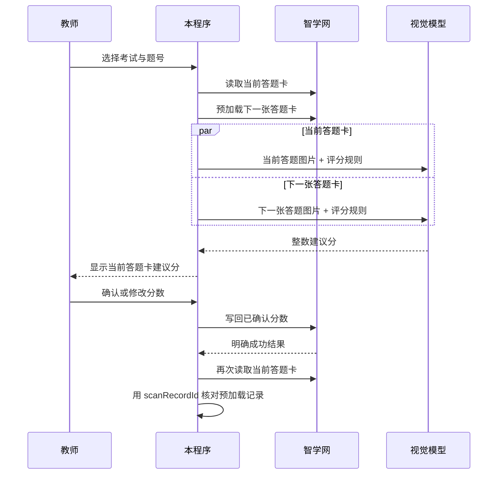

# 连续批改工作流

当前程序已经能读取指定题目的当前答题卡，并预加载同题的下一张答题卡。预加载接口返回的下一张记录可用于提前调用视觉模型，但不能据此跳过教师确认或直接写分。

## AI 配置

复制 `config.example.json` 为本地 `config.json`，填写 `openai_compatible.base_url`、`api_key`、视觉模型名，以及唯一的 `grading.prompt` 字段。将完整题干、标准答案、评分细则和输出格式均写入这个 Prompt。`config.json` 已被 `.gitignore` 排除，不应提交或共享。也可以用 `OPENAI_API_KEY` 环境变量覆盖配置文件中的密钥。

接口使用 OpenAI Chat Completions 兼容路径 `<base_url>/chat/completions`，图片以 URL 形式发送。当前答题图片会发送给你配置的模型服务，使用前应确认该服务符合学校的数据处理要求。

调用使用官方 Python SDK 的 `from openai import OpenAI`。SDK 会对短暂连接错误、超时、限流和服务端错误最多重试两次；分数回填不会自动重试。

程序在开始评分前会发送一次仅含 `Reply with OK.` 的轻量请求，显示接口连通性与往返耗时，不发送学生答题卡。若该耗时已很高，瓶颈在模型服务或网络；若轻量请求很快而评分慢，通常是高分辨率图片处理与模型视觉推理耗时。

## 双槽队列

## 必须遵守的顺序

1. 用 `scanrecorddetail` 获取当前答题卡，保存其 `scan_record_id`、题号和图片 URL 于内存。
2. 用 `preLoadScanrecorddetail` 获取下一张；仅当它存在时才并行向模型请求建议分。
3. 模型必须只返回 `0` 到该题满分之间的整数。解析失败、图片为空或题号不一致时标记人工处理。
4. 教师在终端确认或修改当前分数后，才允许调用回填接口。
5. 回填超时或响应不明时，禁止自动重发。应重新读取平台当前分数/状态后由教师决定。
6. 回填成功后重新读取当前答题卡。只有新的 `scan_record_id` 与预加载记录相同，后续才可安全复用该预加载答卷的 AI 建议；否则应丢弃预加载结果并重新评分。当前版本只做该 ID 安全核对，暂不复用预加载的评分结果。

当前命令行已经实现“提交后重新读取”的循环：若重读到的 `scan_record_id` 与刚提交的相同，程序会停止，防止对同一答卷重复写分；若不同，则继续处理下一张。

对 MiMo V2.5 Pro，程序通过 OpenAI SDK 的 `extra_body` 传入 `thinking: {"type": "disabled"}`，关闭默认的思考模式。AI 接口被强制限制为最多 16 个输出 token，且只允许 JSON 格式 `{"score": 整数}`，不应返回推理过程。教师可直接按 Enter 确认，或输入整数修改；`q` 会跳过当前答卷。AI 建议分绝不会直接提交。

## 已确认的回填协议

当前单题回填使用 `POST /marking/marking/commitTopic/`。提交时必须带上当前答题卡响应中 `topicInfo.item.id` 的 JSON 数组，以及 `{题号: 整数分数}` 形式的 `markingScores`。接口返回 `{"result":"success"}` 才视为提交成功。

程序会检查分数为满分范围内的整数，并要求教师输入 `y` 进行二次确认后才会发送请求。网络超时、非 JSON 响应或非 `success` 响应不会自动重发。

仍建议后续补充一次“提交后重新读取平台显示分数”的核对接口或页面请求，以防网络中断时无法确认最终写入状态。

## 建议模块

| 模块 | 责任 |
| --- | --- |
| `card_fetcher.py` | 读取当前答题卡、预加载下一张（已实现） |
| `grading/provider.py` | 调用配置的视觉模型，返回严格整数建议分 |
| `grading/validator.py` | 验证模型输出、满分范围与题号映射 |
| `workflow.py` | 维护当前/预加载双槽队列、确认状态与 ID 核对 |
| `score_submitter.py` | 仅提交教师确认过的分数，并验证平台结果 |

## 桌面界面

运行 `python -m zhixue_grading.desktop` 后，先在登录页粘贴当前浏览器会话的 Cookie，可点击登录按钮或按 Ctrl+Enter。程序用该 Cookie 在后台读取待阅考试；验证成功后清空输入框并进入评分工作台，验证失败时可修改后重试。Cookie 仅在本次运行的内存中使用，不从配置文件读取，也不会保存到配置文件。进入工作台后，左侧选择题号，右侧显示答题卡和 AI 建议分；可直接修改最终分数并按 Enter 提交。网络请求与 AI 评分均在后台线程执行。

工作台顶部会显示本次加载题目概览的已阅题数。选择“手动确认”后，AI 建议分只会填入输入框，教师确认后才提交；选择“自动接受 AI”后，建议分会立即按相同的校验和提交流程写回，并跳至下一张。只有平台确认提交且返回不同答卷时，已阅题数和左侧对应题目的已阅数才会增加；提交失败或平台仍返回当前答卷时，计数不会变化。

点击工作台顶部的“编辑 Prompt”可查看并修改评分 Prompt。窗口默认显示程序启动时从 `config.json` 读取的 `grading.prompt`；点击“应用”后仅影响本次运行中后续发起的 AI 评分，不会改写本地配置文件。

编辑窗口的“题型预设”下拉框标注并提供以下模板：文言文翻译、文言文阅读（内容理解与表达效果）、古诗文默写填空、现代文阅读（句意理解与主题探究）、古诗鉴赏（表现手法）、综合材料（填空与关系分析）。选择预设时，程序只将模板文本复制到编辑框；教师可继续修改这份副本，原始预设始终保持不变。切回“当前 Prompt（config.json）”可恢复打开窗口时读取的默认 Prompt。
