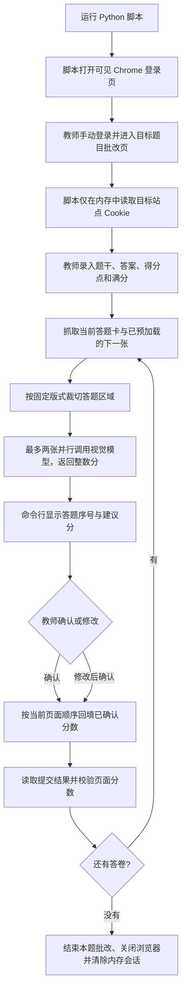
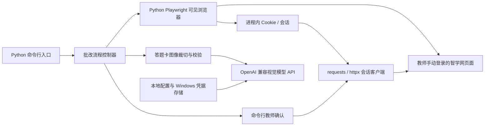

# 智学网语文题目辅助批改工具设计

## 1. 项目目标

为个人教师制作一个 Python 批改脚本，帮助批改智学网当前页面中的语文题目。脚本通过 Playwright 打开可见的 Chrome 页面，由教师手动登录；登录完成后，脚本在内存中取得当前站点 Cookie，并用它研究和调用答题卡读取请求。脚本读取当前答题卡及平台预加载的下一张答题卡，将手写作答图片提交到可配置的 OpenAI 兼容视觉模型，获得整数建议分。教师核对后，由脚本按智学网页面顺序回填最终分数。

程序面向一题多份答卷的快速批改场景。首版通过命令行运行，只处理当前题目和当前页面顺序；不制作桌面界面，不建立学生历史成绩库，不保存批改数据库，不生成评语。

## 2. 已确认需求与约束

| 项目 | 已确认内容 |
| --- | --- |
| 学科与题型 | 语文；选择题、填空题、古文翻译题、简答题等 |
| 作答形式 | 固定版式的手写扫描图片 |
| 答题卡获取 | 当前已登录的智学网教师页面能取得当前答题卡和预加载的下一张 |
| 会话配置 | 教师从本人浏览器复制当前请求的 Cookie 头，并手动放入本机、被忽略的 `config.json` |
| 题目与评分规则 | 教师在程序中手工录入题干、标准答案和得分点 |
| 分数 | 整数；每题设置满分 |
| 模型 | 先用 API；地址、模型名和密钥可配置，兼容 OpenAI API 格式 |
| 运行方式 | Windows 上运行的 Python 程序；命令行交互 |
| 批改节奏 | 一次处理一道题的多份答卷；平台每次最多提供当前与下一张 |
| 智学网写回 | 按当前页面顺序回填最终分数 |
| 存储 | 不使用数据库；批次状态仅驻留内存，图片只作临时缓存 |
| 输出 | 只需要分数，不需要 AI 评语或长篇分析 |

## 3. 设计原则

1. **教师掌握最终提交权。** AI 返回建议分；教师可以快速确认或修改。只有教师确认的分数才提交到智学网。
2. **由教师手动登录。** 脚本启动可见的 Playwright Chrome 页面，教师本人完成登录并进入批改页面；脚本随后只在进程内读取目标站点 Cookie，不向终端打印、不写文件或数据库。
3. **使用已登录页面的正常权限。** 脚本沿教师页面正常使用的请求路径观察与调用请求；不绕过验证码、访问控制或风控。
4. **只采集批改所需数据。** 传给模型的内容限于题目、评分规则和答题区域图片；不主动采集姓名、学号等身份信息。网络分析默认输出脱敏后的接口路径、字段名、类型和状态码，不输出 Cookie、Token、答题正文或图片二进制。
5. **遇到不确定就停在人工复核。** 页面顺序映射不明、图片缺失、AI 输出无效、分数越界或提交状态不明时，不猜测、不自动重试写分。
6. **快速但可恢复。** 仅并行处理平台当前已提供的最多两张答卷；任何时刻都能暂停，不因预取失败丢失当前答卷。

## 4. 用户操作流程



### 4.1 命令行交互

```text
请在脚本打开的 Chrome 窗口中登录智学网并进入本题批改页面。
登录完成后回到终端按 Enter 继续。
题干：...
标准答案：...
得分点：...
满分（整数）：...
答卷 1/__: AI 建议分 __ / __。输入确认分数，或输入 q 暂停：
已提交 / 需检查
```

用户主要操作是手动登录、录入当前题规则、核对分数并确认提交。无需查看 AI 的解释；必要的调试信息留在本机脱敏日志中，不作为评分结果展示。

## 5. 总体架构



### 建议技术栈

- Python 3.11 或更新版本。
- Playwright for Python：启动可见 Chrome，等待教师手动登录，监听页面请求/响应并在内存中读取站点 Cookie。
- `requests` 或 `httpx`：将 Playwright 取得的目标域 Cookie 放入 HTTP 会话 CookieJar，调用已经核实的答题卡/回填请求。
- Pillow / OpenCV：图片读取、旋转、比例校验和固定模板裁切。
- `httpx` 或官方兼容客户端：向教师配置的 OpenAI 兼容服务发请求。
- Windows Credential Manager：保存模型 API 密钥；端点和模型名可通过本机环境变量或本地非敏感配置提供。
- 不引入 SQLite、云端同步、遥测或批改历史服务。

## 6. 模块划分

| 模块 | 职责 |
| --- | --- |
| `main.py` | 命令行入口、参数检查与运行编排 |
| `workflow/grading_controller.py` | 管理本题批次、两张并行队列、顺序映射、暂停与恢复 |
| `zhixue/browser_login.py` | 启动可见 Chrome，等待教师手动登录和进入批改页；从页面上下文读取目标域 Cookie |
| `zhixue/traffic_capture.py` | 监听页面请求/响应，探索答题卡读取、预加载和分数提交请求；输出脱敏结构 |
| `zhixue/session_client.py` | 仅在运行内存中维护 CookieJar、CSRF 等必要会话数据，重放已核实的请求 |
| `zhixue/card_fetcher.py` | 获取当前和预加载下一张答题卡，并维持当前页面顺序 |
| `image/answer_region.py` | 按固定版式定义题目区域、裁切、方向与清晰度检查 |
| `grading/prompt_builder.py` | 将题型、题目和得分点组织成评分输入；要求仅返回整数分 |
| `grading/score_validator.py` | 校验模型响应格式、整数类型、满分边界和题目映射 |
| `providers/openai_compatible.py` | API 地址、模型、密钥、超时、重试和并发控制 |
| `zhixue/score_submitter.py` | 将教师确认分数按平台当前顺序提交，并确认平台结果 |
| `security/local_secrets.py` | 从 Windows Credential Manager 读取模型密钥；不在日志显示密钥 |

模块名称为建议目录结构，具体实现可按首版体量合并。

## 7. 浏览器接入与抓包设计

### 7.1 手动登录与 Cookie 生命周期

本项目不依赖桌面应用、Codex MCP 或 Playwright 浏览器扩展。Python 脚本使用 Playwright for Python 启动一个可见的受控 Chrome/Chromium 窗口，并导航到智学网教师入口。教师本人手动输入账号信息并完成可能出现的验证，进入目标题目的批改页面后回到终端按 Enter 继续。

教师从本人浏览器当前请求中复制 Cookie 头，并手动放入本机 `config.json` 的 `cookies` 字符串。HTTP 客户端仅在运行时使用该字符串；不会打印或进入日志。为保留原始 Cookie 头中的顺序和重复键，客户端不将其转换为 CookieJar，且禁用自动跨域重定向。`config.json` 必须被版本控制忽略、不得共享或提交。程序不得读取或复制 Chrome 磁盘 Cookie 数据库，也不得尝试绕过登录、验证码或会话过期检查。

### 7.2 抓包与请求复用

教师手动登录并进入批改页面后，Playwright 监听页面正常产生的请求和响应。先通过教师在页面中的常规操作识别获取答题卡、预加载下一张和提交分数的请求，再由 Python HTTP 客户端复用已经核实的请求结构。页面上下文在批改期间保持打开，便于重新读取页面状态及判断登录是否过期。

抓包只为确定以下三个操作的请求/响应结构：

1. 读取当前答题卡及平台预加载的下一张图片。
2. 在教师正常切换答卷时，确认页面顺序和图片对应关系。
3. 教师确认之后提交当前答卷分数，并读取成功/失败结果。

需记录的结构信息包括：请求方法、去除查询值后的路径、请求体字段名/类型、响应字段名/类型、HTTP 状态码、顺序字段含义以及失败码。具体 URL、字段、认证方式和响应结构均待真实页面抓包确认，本设计不提前假设接口名或参数含义。完整请求只在当前进程内存中短暂保留，供教师核对后复用；日志和文档仅记录脱敏结构。

### 7.2 抓包范围

抓包只为确定以下三个操作的请求/响应结构：

1. 读取当前答题卡及平台预加载的下一张图片。
2. 在教师正常切换答卷时，确认页面顺序和图片对应关系。
3. 教师确认之后提交当前答卷分数，并读取成功/失败结果。

需记录的结构信息包括：请求方法、去除查询值后的路径、请求体字段名/类型、响应字段名/类型、HTTP 状态码、顺序字段含义以及失败码。具体 URL、字段、认证方式和响应结构均待真实页面抓包确认，本设计不提前假设接口名或参数含义。

### 7.3 抓包脱敏

- 不输出或保存 `Cookie`、`Authorization`、Token、签名、验证码、完整 URL 查询值或图片地址。
- 仅生成字段树/类型树；对象字段的值不记录。字符串仅标记为 `string`，数组仅描述元素类型/结构。
- 图片响应只记录 MIME 类型、字节长度及字段位置，不输出 Base64 或图像内容到抓包日志。
- 动态路径 ID 与学生/作业标识在报告中替换为占位符。
- 抓包过程不调用写分请求；提交接口只在后续实现中由教师确认动作触发。
- 对平台请求/接口的使用遵守账号权限、平台规则和学校要求；页面失效或出现挑战验证时交由教师本人处理。

## 8. 答题卡处理与顺序映射

1. 以智学网当前可见题目/答卷为顺序基准，创建本批次的临时序号 `0..n-1`；序号不等于学生身份。
2. 每次只向平台读取其正常提供的当前图片和预加载下一张，最多在本地积压两份待处理图片。
3. 在固定答题卡模板下裁切当前题目答题区域。首版可由教师设置一次裁切区域（归一化坐标），并在每张图上检查尺寸、方向与空白情况。
4. 保存图片与当前序号的短期映射，只保存在内存；必要的临时图片放入随机命名目录，批次结束、异常退出重启或教师手工清理时删除。
5. 图片与序号无法可靠配对时，将该份标记为“需检查”，禁止向智学网提交。
6. 该功能只读取页面当前可访问的数据，不通过猜测 ID 或批量遍历接口扩展范围。

## 9. AI 评分设计

### 9.1 模型输入

- 当前题目的题型、题干、满分、标准答案和逐点得分规则。
- 当前答题卡中裁切出的作答图片；图像由用户配置的视觉模型 API 接收。
- 仅需的顺序序号，不发送学生姓名、学号、班级或智学网凭证。

### 9.2 模型输出

只要求一个严格结构化的整数分数，例如：

```json
{"score": 3}
```

不要求评语、思维过程或解释。程序校验 `score` 必须为 JSON 整数，且满足 `0 <= score <= max_score`。不符合时只允许一次受限格式重试；仍无效则转人工处理，不写回。

### 9.3 评分规则

- 选择题：如答题区域和选项识别可靠，使用本地答案键直接比对，减少延迟和 API 调用；无法识别或多选规则复杂时调用视觉模型。
- 填空题：依据标准答案、可接受异体/同义表达和满分规则评分。
- 古文翻译、简答题：依据教师录入的得分点逐点判定，只输出合计整数分。
- 题目中可为部分得分点设置明确整数分值，所有分值之和不得超过满分。
- 将答卷中的文字视为学生作答内容，不允许其覆盖或改变系统评分规则。
- API 不可用、模型不支持图像、图像模糊或输出无效时标记“需人工评分”。

### 9.4 API 配置

设置项：API Base URL、模型名称、可选兼容参数、请求超时、并发数（首版上限 2）。API 密钥保存于 Windows Credential Manager，不写在源码、日志或共享配置中。仅当服务明确支持视觉输入和严格 JSON 输出时启用相应能力；不支持时在终端显示配置错误，不默默退化为错误模式。

## 10. 回填与教师确认

- AI 完成后在终端显示当前临时序号与整数建议分；教师可直接确认或输入修正后的整数分。
- “确认并提交”是明确的写回边界。未确认、待复核、分数越界、答卷映射不清晰的记录不能提交。
- 按智学网当前页面顺序提交已确认分数；若平台支持单条提交，则一张一提交并即时校验；若只能批量提交，则在确认整个待提交集合后按抓包验证的结构发送。
- 提交后读取页面状态或响应结果，显示“已提交”“失败”或“结果不明”。
- 网络超时且无法判定是否写入时，不自动重发，先重新读取当前页面分数，避免重复或错位提交。
- 回填接口细节尚未抓包，首版实现前必须通过真实教师页面确认请求字段及平台反馈。

## 11. 错误处理与状态机

单份答卷状态：

```text
待获取 → 已获取 → 评分中 → 待教师确认 → 已确认待提交 → 已提交
   └──────────────→ 需人工检查 ←──────────────┘
```

| 情况 | 程序行为 |
| --- | --- |
| Playwright 浏览器未启动或仍停留在登录页 | 等待教师手动登录并进入教师批改页 |
| 当前图或预加载图未出现 | 保留已获取的答卷，等待教师正常翻页或手工重试 |
| 图片为空、损坏、题区裁切异常 | 标记需检查，不调用模型/不写回 |
| API 超时/限流/服务错误 | 对只读评分请求做有限退避重试；超过上限转人工评分 |
| 模型输出不是整数或超出满分 | 格式纠正重试一次，失败后转人工评分 |
| 页面顺序发生变化 | 暂停整个提交队列，重新核对映射 |
| 提交结果不明 | 不重复提交；读取页面现状后由教师决定 |
| 用户关闭脚本/浏览器 | 取消未提交请求并释放内存 Cookie 与临时图片；已提交结果以平台为准 |

## 12. 隐私与安全

- 账号密码由教师在可见浏览器中手动输入，不由脚本读取。Cookie 只从当前 Playwright 上下文临时读取到内存，以便本批次发送已核实的请求；不得输出、持久化或加入任何请求日志。
- 学生作答图片属于学生作业数据。发送给云 API 前在终端说明当前配置的服务商；默认仅发送题目区域图片和必要的评分文字。
- API 密钥存入 Windows Credential Manager 或仅在进程启动时从本机环境变量读取；智学网 Cookie 由教师保存在本机、被 `.gitignore` 排除的 `config.json` 中，不打印、不进入日志且不提交到仓库。
- 不保留跨批次作答图、成绩和 AI 请求历史；错误日志只含时间、状态码、脱敏接口、临时序号和错误类别。
- 如图像接口需要临时文件，限制目录权限并在批次完成后清理；脚本异常退出后在下次启动时清理自身命名的残留临时目录。
- 不自动点击验证码、挑战或安全警告，不尝试绕过平台权限与机制。

## 13. 验收标准

1. Python 脚本能启动可见浏览器，教师可手动登录并进入一道题的教师批改页面。
2. 脚本从当前 Playwright 上下文取得必要 Cookie，且 Cookie 不出现在终端、日志、配置文件和数据库中。
3. 已登录后，脚本能正确获取当前及下一张答题卡，并证明图片与当前页面顺序的映射正确。
4. 一次只保持最多两份图片待处理，并能并行调用配置的视觉模型。
5. 模型结果严格为满分范围内的整数；无效输出不会进入提交流程。
6. 教师能核对或修改分数，并只提交确认过的分数。
7. 回填顺序与当前智学网页面一致；提交结果能通过响应或页面状态核对。
8. 抓包日志和程序日志不含 Cookie、Token、学生身份值、作答正文或图片内容。
9. 脚本结束后不留下应用数据库、成绩历史或跨批次答卷缓存。

## 14. 分阶段实施

### 阶段 A：连接与协议确认

- 配置教师手动复制的当前 Cookie 头；确认其仅用于本机运行时 HTTP 请求且不进入日志。
- 从教师当前页面确认答题卡读取、预加载下一张、答卷顺序和分数提交的请求结构。
- 输出脱敏字段树；验证抓包过程中没有写回动作。

### 阶段 B：本地批改原型

- 实现题目/评分规则输入、固定模板裁切、当前与下一张图片队列。
- 接入可配置 OpenAI 兼容视觉 API。
- 在终端显示答卷临时序号与整数分，支持教师修改和提交前确认；答题卡仍由已登录的智学网页面显示。

### 阶段 C：回填与异常恢复

- 按已核实的协议实现顺序回填和状态核对。
- 加入超时、限流、映射失效、页面刷新、重复提交风险等处理。
- 用教师可安全控制的题目/环境完成端到端检查，再用于真实批改。

## 15. 待确认事项

以下问题需要在实际抓包后确定，不应在实现前虚构：

- 当前答题卡与预加载下一张分别由哪些请求触发，图片在 JSON、二进制响应还是独立资源中。
- 响应中用于保持答卷顺序的字段，以及翻页后下一张如何成为当前张。
- 分数是逐份逐题提交还是页面批次提交；提交是否需要同时发送题目、答卷或评分任务标识。
- 分数提交成功的权威判断方式、失败码和幂等行为。
- 答题卡图片是否已经仅含单题区域，或需要按坐标裁切。
- 智学网页面刷新、断线或批改任务切换时，如何安全恢复当前序号。
- 用户选择的模型服务商、模型名称、视觉能力和 JSON 输出能力。

## 16. 当前实施状态

- 需求与首版 Python 命令行工作流已确认；本文档是设计稿，程序代码尚未实现。
- 登录方式为教师在脚本启动的可见浏览器中手动登录；脚本只在内存中使用该运行会话的 Cookie。
- 本 Python 程序直接使用 Playwright for Python，不依赖 Codex Playwright MCP。
- 智学网答题卡读取与分数回填协议尚未实际抓取，相关实现仍待教师页面连接后确认。
