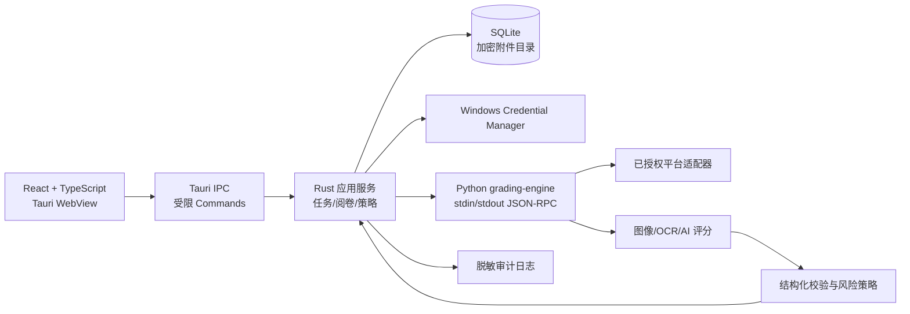
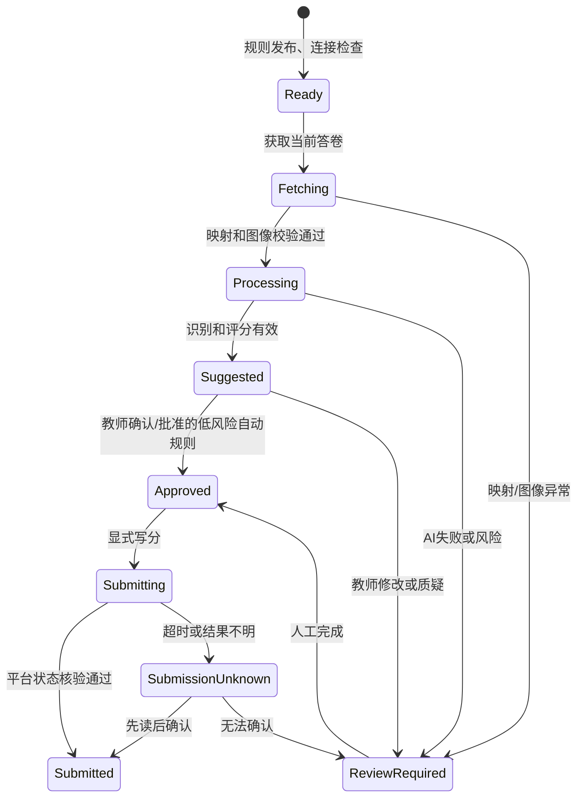

# AI 智能阅卷 Windows 桌面程序设计文档

**状态：** 架构设计稿（基于 CC Switch 技术框架更新）  
**首发平台：** Windows x64；预留 macOS/Linux 能力。

## 技术路线：Tauri 2 桌面框架

本产品借鉴 [CC Switch](https://github.com/farion1231/cc-switch) 的成熟工程方式：React 前端只处理体验，Rust 原生后端负责本机资源、持久化和安全边界，桌面能力通过受控插件提供。该项目实际使用 Tauri 2、React、TypeScript、Vite、pnpm，Rust 端使用 Tokio、SQLite、系统托盘、窗口状态、对话框、日志和自动更新插件。[前端依赖](https://raw.githubusercontent.com/farion1231/cc-switch/main/package.json) [Rust 依赖](https://raw.githubusercontent.com/farion1231/cc-switch/main/src-tauri/Cargo.toml)

- 桌面壳：Tauri 2；Windows 打包为签名 NSIS/MSI，更新包必须签名验证。可参考 CC Switch 的 [发布与更新配置](https://raw.githubusercontent.com/farion1231/cc-switch/main/src-tauri/tauri.conf.json)。
- 前端：React 18 + TypeScript + Vite + pnpm；Tailwind CSS、Radix UI/shadcn 风格组件、TanStack Query、Zod、React Hook Form、i18next。
- 原生后端：Rust + Tauri Commands + Tokio；`reqwest` 负责网络、`rusqlite` 负责 SQLite 原子事务、`serde` 管理 DTO/JSON Schema。
- 既有 Python：不保留 Tkinter UI。将当前 `zhixue_grading` 演进为随安装包附带的 `grading-engine` sidecar，经 stdin/stdout JSON-RPC 由 Rust 调用，用于已验证的平台适配、Pillow/OpenCV 图像处理和视觉 AI 调用。
- 安全：前端不得直接访问 Python、平台接口、文件系统或密钥。Tauri Capability/Permission 必须对命令、目录、域名最小授权；仅允许学校/模型白名单，不能照搬通用工具的宽泛 HTTP CSP。

## 总体架构



## 项目结构

```text
src/                               # React + TypeScript 前端
  features/                        # 任务中心、阅卷台、规则、风险、设置
  lib/tauri.ts                     # 类型化 IPC 客户端
  contracts/                       # JSON Schema、DTO
src-tauri/                         # Rust Tauri 应用
  src/commands/                    # 输入校验后的 Tauri Commands
  src/application/                 # 阅卷、提交、恢复用例
  src/domain/                      # 状态机、规则、审计实体
  src/infrastructure/              # SQLite、凭据、日志、sidecar
  capabilities/                    # 最小权限定义
grading-engine/                    # 从 zhixue_grading 演进的 Python sidecar
  protocol/                        # 版本化 JSON-RPC
  adapters/                        # 平台、AI、图像适配器
tests/                             # frontend、rust、python、contract、e2e
```

## 从当前 Python 迁移的功能

| 现有能力 | 产品化归属 |
| --- | --- |
| 考试列表、题目概览 | React 任务中心 + Rust 任务服务 |
| 当前/下一张答题卡预取 | Python 引擎有界队列；结果绑定答卷 ID 与内容哈希 |
| 答题卡展示 | React 高清查看器，缩放/旋转/题区标注 |
| 手写转录及不确定性 | 识别阶段；可编辑转录与风险标志 |
| AI 建议分和严格整数校验 | 评分阶段；JSON Schema、满分与逐点评分二次校验 |
| Prompt 模板与教师编辑 | 规则工作台；发布即生成不可变版本 |
| 人工/自动提交、平台回填 | Rust 状态机、提交事务、平台状态核验 |

## 需要吸收、但不应照搬的 CC Switch 设计

| 借鉴 | 在阅卷产品的落地 | 不照搬原因 |
| --- | --- | --- |
| SQLite 原子写入 | 会话、答卷状态、规则版本、提交记录、审计 | 答卷图片和凭据不能按一般配置数据处理 |
| Tauri 插件化 | dialog、log、updater、single-instance、window-state | 不开放任意 shell/process/filesystem 权限 |
| React 查询与虚拟列表 | 考试/题目/风险答卷大列表 | 所有数据经 Rust IPC，不在前端直连平台 |
| 系统托盘和窗口恢复 | 后台预取状态、任务通知、崩溃恢复入口 | 不提供“后台自动提交”默认行为 |
| 自动更新 | 签名更新、灰度发布、回滚 | 适配器变更先过契约测试，失败时关闭写入 |

## 阅卷工作流



写入的硬规则：答卷 ID、题号、内容哈希、规则版本与满分必须一致；提交超时只允许先读取平台状态，不允许自动重发。

## 数据与安全

- API Key、平台会话只放 Windows Credential Manager；不进入前端状态、SQLite、截图、日志或导出文件。
- SQLite 保存批次、规则、处理状态、最终分与追加式审计事件；图片位于受保护附件目录，默认只短期缓存当前/下一张/复核件。
- AI 评分分两阶段：先将图片识别为可编辑的最终作答和风险信息，再仅对该转录与规则评分；结构化输出必须包含 `score`、`maxScore`、`criterionScores`、`confidence`、`riskFlags`。
- 默认人工确认。自动提交仅在题目级明确启用，且图像、映射、规则、置信度和模型一致性都满足阈值时发生。

## 实施顺序

1. 搭建 Tauri 2 + React + Rust 工程壳、Capabilities、SQLite、日志和测试基线。
2. 将 Python 当前业务封装为 JSON-RPC sidecar，先做到“人工确认后回填”的等价闭环。
3. 建设答题卡查看器、规则工作台、风险队列与审计恢复中心。
4. 接入结构化 AI 评分、金样本评测和低风险自动批准。
5. 完成签名安装、自动更新、学校策略与多平台适配器。

## 待确认问题

1. 是否确认采用 Tauri 2 + React + Rust 作为正式客户端路线，并将 Python 仅保留为引擎 sidecar？
2. 首发是否仅支持智学网，且平台的读取/回填自动化已有授权？
3. 学生答题卡是否允许传给云端 AI；若不允许，是否需要校内私有化模型？
4. 首发题型、自动提交边界，以及是否需要导入本地扫描 PDF/图片？
5. 个人教师、教研组还是学校统一部署？这决定是否需要中心服务、多人协作和集中审计。
